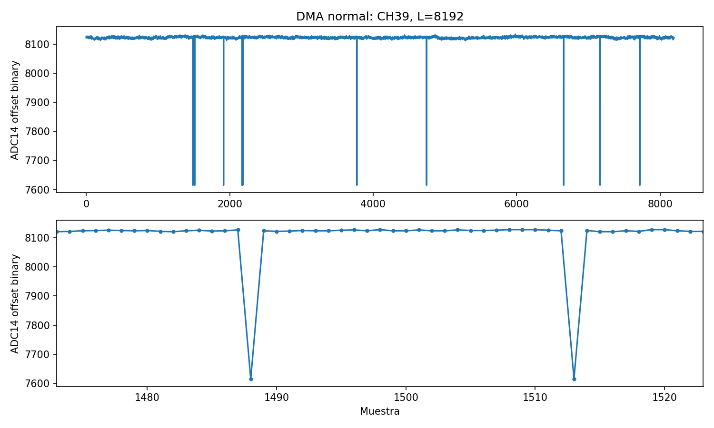

# Offset, alineación y latencia de raw DMA

La conversión del cliente tenía un error de formato: las capturas DMA de
ADC normal se exportaban como unsigned sin convertir complemento a dos.
La corrección devuelve el cero analógico a aproximadamente 8192 cuentas.
Los errores intermitentes de CH39 son un problema distinto y **siguen sin
resolver**. Un PASS de rampa no ha demostrado estabilidad con señal normal.

Fecha del PC: 2026-10-11 CEST. El reloj de DAPHNE registra estas pruebas el
2026-10-10 UTC. Esta sesión midió el firmware `0x0e501139`, ABI 2.0; el ID
identifica la evidencia, no fija la implementación de producción a ese build.
El servidor manual sigue en `193.206.157.36:40001`.

## Formato ADC corregido

El servidor exige ADC14, serialización 16x, LSB primero y
`ADC_OUTPUT_FORMAT=0`. Según el
[datasheet AFE5808A, tabla 3](https://www.ti.com/lit/ds/symlink/afe5808a.pdf),
el bit 4[3]=0 selecciona complemento a dos, mientras que 1 selecciona
offset binary. Los dos bits bajos del serializer son padding.

La exportación compatible con los archivos y gráficas existentes es:

```python
adc14_offset_binary = ((raw16 >> 2) & 0x3fff) ^ 0x2000
```

Se comparte en `osc.py` y `protobuf_acquire_list_channels.py` mediante
`DmaClient`. Se rechaza padding no nulo y se conserva CANCEL ante errores.
No se cambió el formato del servidor ni se reprogramó el ADC para solucionar
el offset. El código SpyBuffer permanece intacto.

La adquisición real con el cliente actualizado, ejecutado en ARM, guardó
dos waveforms de 2048 muestras para CH0 y CH17. Cada archivo ocupa 8192 bytes.
CH0: media 8211.81, sigma 2.10, rango 8205–8219. CH17: media 8144.14,
sigma 2.16, rango 8137–8152. La componente DC depende de la configuración y
del canal; el cliente no fuerza todos los valores a 8192.

Los datos antiguos siguen teniendo la codificación original. Usar una carpeta
nueva. Los clientes escriben `dma_format.json` y rechazan append sobre archivos
con codificación desconocida. El marcador se registra después de abrir los
archivos, para evitar declarar convertido un archivo que no llegó a truncarse.

## Error intermitente observado

En CH39 se observan muestras aisladas aproximadamente 512 cuentas por debajo
de su baseline. Un ejemplo concreto de la captura corregida es:

```text
ADC14: 8123, 8124, 8127, 7615, 8124, 8122, 8123
raw16: feec, fef0, fefc, f6fc, fef0, fee8, feec
```

La diferencia `0xfefc ^ 0xf6fc = 0x0800` corresponde al bit raw 11, ADC 9
tras desplazar dos bits. Los bits de padding siguen siendo cero. Es una
observación de los datos raw recibidos; no establece por sí sola si el origen
está en LVDS, deserialización, transporte interno, DMA o el ADC.



Se verificaron los taps del scan manual usando 32768 muestras por punto y
1048576 para la comprobación final: AFE0–3 pasaron; AFE4 no encontró ojo en
tap 296, slip 6, con 28 transiciones incorrectas en CH39 en ese punto.
Un nuevo barrido 240–340 encontró 286–306, tap 296/slip 6, y pasó una rampa
de un millón una vez; una captura ADC posterior volvió a presentar errores.

También pasaron rampas de un millón en tap 4/slip 7, 300/slip 6 y 304/slip 6.
Las capturas ADC de 10 × 32768 muestras tuvieron respectivamente 44, 303 y
285 muestras separadas más de 256 cuentas de su mediana, todas en lane 7.
Ese criterio localiza outliers en estas señales quietas; no es un validador
universal de waveforms con pulsos. Verificaciones posteriores en taps
0, 1, 2, 8 y 12 fallaron la rampa final; tap 6 no tuvo punto válido.

Por tanto, no se eligió un tap que oculte el fallo ni se filtraron muestras.
La consulta posterior confirma **AFE0–3 ALIGNED, AFE4 FAILED**, DMA disponible,
sin trabajo activo tras ACK/CANCEL. CMA: 524288 kB total, 514104 kB libre.
No se modificaron servicios, módulos, firmware, DACs ni el perfil de arranque
durante esta investigación. La política de todos los AFEs es la misma.

La lectura RPC `readAFEReg` actualmente consulta el diccionario cacheado del
servidor. Sus ceros en registros 2/3/4/10/51/52 no son evidencia SPI actual:
configuración y scanner escriben por otra ruta. El diagnóstico siguiente usa
lectura SPI física, fuera del servidor y con consumidores detenidos.

## Coste del scan y de la actualización

Se redujo a 2048 la longitud por defecto de los puntos de búsqueda DMA;
la verificación final pasó a 1048576, conservando el mínimo de 32768 del
servidor. La rampa tiene 16384 códigos: 2048 no cubre un ciclo completo en
cada punto, mientras que el final cubre 64 ciclos. Los puntos cortos permiten
buscar rápidamente; el final largo sigue siendo obligatorio al aplicar.

Un barrido completo de 0–511, 16 slips, coarse 16/fine 4, búsqueda de 2048 y
verificación de un millón tardó 21.532 s para cinco solicitudes, unos 4.3 s
por AFE. Sus PASS describen esas capturas de rampa; las pruebas ADC posteriores
demuestran que no cualifican por sí solos la estabilidad de CH39. El servidor
refina todo el rango cuando un slip no tiene ojo coarse, lo que también suma
capturas. No se eliminó ese fallback.

| CH0, L=2048, N=1 | Tiempo observado |
| --- | ---: |
| PC, cliente anterior, primeras 8 repeticiones | 147–150 ms |
| PC, cliente corregido, sesión ya negociada | 101–103 ms |
| Propia DAPHNE, cliente corregido, 10 repeticiones | 6.03–6.77 ms |

Se quitó una negociación redundante por waveform y la espera fija de 20 ms
antes del primer STATUS. El backoff solo actúa si STATUS aún dice RUNNING.
Cada RPC desde el PC tarda aproximadamente 25 ms. Un waveform de una ruta
todavía necesita ACQUIRE, STATUS, READ y ACK, frente a un dump legacy.
Una selección en tres rutas necesita más READs. Reducir L no elimina esos
viajes de red. No se implementó ring ni continuidad entre STARTs.

## Validación y evidencia

- Compilación completa ARM por SSH en la copia aislada: PASS.
- CTest ARM: 22/22 casos sin fallos; el caso Qt omite sus dos pruebas por
  dependencias opcionales ausentes. Las dos pruebas Qt sí pasan en el PC.
- Cliente: 9 pruebas, incluyendo límites con signo, padding, orden multirruta,
  archivos, ACK/CANCEL y rechazo de append antiguo.
- Diagnóstico de patrones: 4 pruebas de análisis raw, incluyendo wrap,
  corrupción del bit 11, toggle, padding y outliers ADC.
- Cliente de archivos real en DAPHNE: N=2, L=2048, CH0/17, PASS.

El [resumen de mediciones](assets/dma-alignment-20261011/measurements.json)
conserva geometría, estadísticas, trazas RPC, resultados compactos del scan,
estados actuales y hash SHA256 de la captura raw del PC. Las capturas completas
permanecen en `build/dma-alignment-investigation-20261011/`, fuera de Git.

## Diagnóstico físico preparado, pendiente de ejecución privilegiada

[diagnose_dma_patterns.py](../scripts/validation/diagnose_dma_patterns.py)
compara rampa, toggle, constantes, custom y ADC normal en una posición fija.
Registra errores raw por bit y ejemplos por lane. No declara ALIGNED ni
selecciona un nuevo tap. Usa los helpers físicos cualificados de la sesión,
exige build esperado y consumidores detenidos, y restaura patrón, timing y VTC.
La aceptación del formato ADC se verifica por SPI real. Una cuarentena impide
restauración MMIO y exige conservar el overlay cargado.

Se dejó en `/tmp/dma-server-review-20261010/scripts/validation/`. La ayuda y
el análisis offline se probaron en ARM; **los patrones físicos de esta nueva
herramienta aún no se ejecutaron**. SSH del usuario funciona, pero `sudo -n`
requiere contraseña. El operador puede ejecutar lo siguiente en DAPHNE,
después de cerrar osc y otros clientes:

```sh
sudo systemctl stop daphne-dma-manual.service &&
sudo /usr/bin/daphne-afe-dma-quiesce &&
sudo python3 /tmp/dma-server-review-20261010/scripts/validation/diagnose_dma_patterns.py \
  --board-helper /opt/daphne-dma-manual-20261010/align_afe_dma_provisional.py \
  --dma-helper /tmp/dma-server-review-20261010/daphne-server/dma/daphne-afe-capture.py \
  --expected-build-id 0x0e501139 --afes 4 --taps 292,296,300 --bitslip 6 \
  --length 1048576 --repeat 3 --output /tmp/dma-pattern-review-20261011
```

El build de este comando corresponde únicamente a la sesión actual; para
otro firmware se necesita el helper cualificado correspondiente. Para comparar
otros AFEs, usar `--afes 0,1,2,3,4` y omitir taps/bitslip para medir los ajustes
actuales de cada uno. La primera ejecución se concentra en el fallo observado.

Revisar `report.json`, `before.json`, `after.json` y cualquier `quarantined`.
No reanudar el servidor si `restoration_verified` es falso o no se confirma
reposo. Con restauración y reposo confirmados, se puede arrancar nuevamente
el servidor manual:

```sh
sudo /usr/bin/daphne-afe-dma-quiesce &&
sudo systemctl start daphne-dma-manual.service
```

El reinicio invalida toda evidencia de configuración/alineación del servidor:
volver a configurar y escanear antes de adquirir. Un resultado defectuoso en
los patrones exige investigar el frontend/firmware; no habilitar CH39 por flag.
