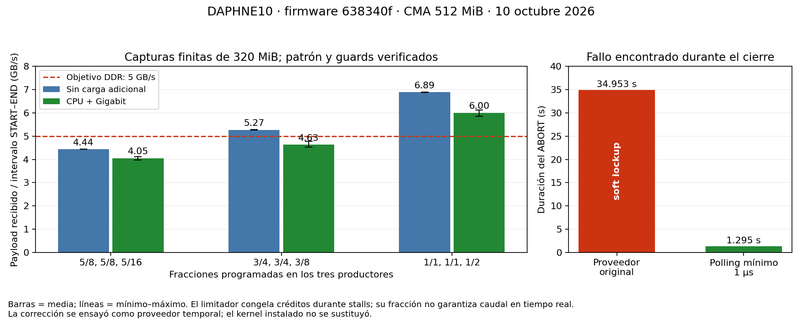

# Punto 3 DMA: calificación en DAPHNE10, 10 octubre 2026

## Resultado

**Punto 3 cerrado: diagnÛstico Linux con proveedor corregido.**
El usuario aceptÛ la calificaciÛn de placa existente y solicitÛ el cierre
con comprobaciones mÌnimas, sin repetir la campaÒa exhaustiva.
El cierre corresponde al cÛdigo y al proveedor corregido ensayado. La imagen
que use DMA debe incorporar el parche; el kernel habitual instalado conserva
el defecto de ABORT y no queda calificado para DMA. No se reconstruyÛ ni
reemplazÛ ese kernel para este cierre.

Se verificaron 372 capturas de ruta y 12 323 858 816 bytes de payload, incluidos
STOP con drenado. Hay transferencias individuales y simult√°neas, seeds con wrap,
SG por encima de 4 MiB, un paquete de 64 MiB + 16 bytes y direcciones DMA altas.
El diagnóstico contiene patrones sintéticos; la captura física AFE corresponde
al punto 4. Anillo y descarga de adquisición siguen pendientes, puntos 5–7.



## Identidad y condiciones

| Elemento | Identidad utilizada |
| --- | --- |
| Gateware | `638340f8ffd42c92fa8815b2ddce562a878e0cd8`, mismo bitstream ILA existente |
| Software base | `daphne-os` `aa1b7a0`, diagnóstico separado |
| Kernel instalado | `6.18.10-xilinx-g4f7afe14f724` |
| Kernel source | `4f7afe14f7246986ca858d9a0880f5db6ba02a4b` |
| App temporal | `daphne_rawdma_qual_638340f`, overlay derivado del mismo build; tres proveedores/clientes |
| Identidad | magic DAPH, ABI 2.0, variante 3, build `0x0638340f`, capacidades `0x520` |
| DMA/productores | `B002/B003`, `B004/B005`, `B006/B007`; HP0/HP1/HP3, 128 bits, 40 bits, SG 26 bits |
| CMA | 524288 kB total, 515080 kB libre al restaurar |
| Cliente | `max_pool_mib=448`, propietario exclusivo por ruta; DMAengine administra SG/IRQ |
| Boot ID | `946d9ebe-4d72-4266-8e9c-02e344931c21`, sin cambios durante ambos ensayos |

Checksums SHA-256:

- Bitstream bin: `9d8f6546209a2b72c71dae798dacc37ded7b8a98d45b3d1194d2a26e9195587c`.
- DTBO de tres rutas: `8efaa8997f2e1b5e8c0019cfba56b55034c78386b48df8057de9322a5eeb129d`.
- Herramienta: `531a0fb37c12a6d6909a34efedafb805fff710e3f450ebb764c872fa6d9020be`.
- Cliente kernel: `16020faebea0f5a6bff739db77c16c0bf785e303f4b6367764def5ee25f18300`.
- Fuente original `xilinx_dma.c`: `f8885375f66921bfa5eb2a38acf24798c3c92ba615f57310419f21adb90bdbdb`.
- Proveedor temporal corregido: `b777e56be37ce9d03b68dd37e812ba0bb05644a90cefe1b98b212cdeb4515817`.

La recompilación del cliente desde la corrección propuesta produce exactamente
el SHA del módulo ensayado. Se retiró `no_llseek`, eliminado de Linux 6.18;
no se cambió su ABI ni el camino spybuffer. El proveedor privado usa otro nombre
de driver y export VDMA para coexistir con el proveedor integrado. Solo se
reasignaron los tres dispositivos experimentales, tras liberar el cliente.
Las modificaciones de nombres y del include interno son exclusivamente del
ensayo, no del parche kernel de entrega.

## Fallo encontrado y corrección

ABORT se solicitó durante un paquete largo con tasa `1/100000`, antes de TLAST.
La traza real es:

```text
watchdog: BUG: soft lockup ...
xilinx_dma_stop_transfer
halt_dma_path [daphne_dma_diag]
abort_job [daphne_dma_diag]
path_ioctl [daphne_dma_diag]
```

`xilinx_dma_poll_timeout` invocaba `readl_poll_timeout_atomic` con delay cero y
un timeout de 1000000 us. La implementación exacta de `iopoll.h` decrementa
solo un nanosegundo nominal por iteración si el delay es cero; puede efectuar
aproximadamente mil millones de lecturas MMIO. Ese timeout nominal no limitó
la espera a un segundo en la placa. No se observó un acceso a memoria inválida
en esta traza: el bloqueo CPU ocurre esperando HALTED en un registro v√°lido.

El parche impone `max_t(unsigned long, delay_us, 1)` en el wrapper de polling.
Mantiene inmediata la primera comprobación y conserva las demoras no nulas.
Cubre stop, reset y start que usan el mismo wrapper. ABORT pasó de **34,953 s
a 1,295 s**, sin nuevos soft lockups. El stop puede agotar su timeout si el
paquete est√° incompleto; el reset posterior termina y el cliente comprueba
HALTED, RUN/RESET desactivados y productor inactivo antes de liberar el payload
con su canal/descriptores. Las nueve advertencias `Cannot stop channel` de
los casos abort/timeout/salida son coherentes con esa recuperación.

El estado ABORT/ERROR de la herramienta conserva el snapshot anterior al reset
para registrar progreso: un RUN de ese snapshot no demuestra que siga activo.
Se comprobó el estado vivo al reabrir en IDLE, con cero bloques/bytes asignados.
Timeout de adquisición de 20 ms no significa retorno a userspace en 20 ms:
la cancelación/reset añade aproximadamente 1,3 s en este caso.

## Pruebas y memoria

| Prueba | Resultado |
| --- | --- |
| Rutas 0, 1, 2 por separado y juntas | PASS, datos completos, contadores y guards |
| Paquete mínimo de 16 bytes, 5 paquetes, 3 repeticiones por ruta | PASS |
| Rearme, 10 repeticiones por ruta; prueba conjunta de 30 ciclos | PASS |
| Seed 0 y `0xFFFFFFF0` con wrap | PASS |
| Paquetes de 4 MiB + 16 B y de 64 MiB + 16 B, SG m√∫ltiple | PASS |
| Direcciones API superiores a 4 GiB | PASS en las tres rutas |
| Exclusión de segundo open, configuración inválida, build incorrecto | EBUSY/EINVAL/ESTALE esperados |
| Cierre después de PREPARE, sin START | PASS, reapertura sin buffers |
| STOP con drenado | PASS en las tres rutas, un paquete íntegro antes de detenerse |
| ABORT y timeout | FAIL de latencia con proveedor original; PASS con parche, en tres rutas |
| SIGTERM y SIGKILL durante adquisición | PASS con parche, reapertura y captura posterior correctas |
| Presupuesto excedido y fallo parcial de preparación conjunta | ENOMEM esperado, recuperación y reapertura correctas |
| Payload de 384 MiB en una ruta | PASS, 402653184 bytes íntegros |
| Payload de 432 MiB | ENOMEM; límite de asignación observado, no tamaño garantizado |
| Recursos tras descarga | CMA vuelve a 515080 kB, módulos/nodos experimentales ausentes |

Los buffers pequeños y las colas de SG de 16 B también se asignaron en la
DDR alta: ejemplos `0x800DC3040`, `0x80E2AA040`, `0x80E254040`. No se inventaron
ni forzaron direcciones. Esta cobertura verifica los campos altos de dirección;
no es una prueba de un buffer de cientos de MiB entero en DDR alta.

El presupuesto lógico de 448 MiB incluye guards/padding del cliente; no garantiza
una reserva contigua de ese tamaño. Cada bloque completo de payload de 4 MiB
requiere 4 MiB + 4 KiB tras guards y PAGE_ALIGN. `CONFIG_CMA_ALIGNMENT=8`
limita el alineamiento CMA a 1 MiB. Gaps, distribución del allocator y otros
consumidores pueden reducir capacidad útil; esta es una explicación plausible
para el fallo de 432 MiB, no una medición de toda la fragmentación. El ensayo
registra el caso como FAIL respecto a la expectativa de captura, y como ENOMEM
controlado respecto al contrato. Se verificó reapertura inmediata después.
No fijar 384 MiB como garantía universal ni 432 MiB como máximo matemático.

CMA mostró fluctuaciones inmediatamente después de cerrar. Tras retirar módulos,
overlay y reactivar el runtime, volvió exactamente al valor inicial, sin caída
sostenida tras los ciclos repetidos. No se inyectó un fallo físico de reset ni
se forzó la ruta de cuarentena que requiere reinicio.

## Throughput medido

Captura balanceada por iteración: rutas 0/1, 16 paquetes de 8 MiB cada una;
ruta 2, 16 paquetes de 4 MiB. Total 320 MiB, memoria verificada después.
Tiempo conjunto: primer START al último END, timestamps monotónicos del kernel.
Incluye rearme/IRQ entre paquetes; excluye la posterior lectura/comprobación CPU
para medir la recepción DDR. No es caudal de una descarga Ethernet de adquisición.

| Fracciones programadas 0/1/2 | Sin carga, media [mín–máx] GB/s | CPU + Gigabit, media [mín–máx] GB/s | Repeticiones |
| --- | --- | --- | --- |
| 5/8, 5/8, 5/16 | 4,440 [4,437–4,442] | 4,051 [3,974–4,119] | 5 + 5 |
| 3/4, 3/4, 3/8 | 5,273 [5,271–5,275] | 4,635 [4,526–4,774] | 3 + 3 |
| 1/1, 1/1, 1/2 | 6,888 [6,885–6,892] | **6,002 [5,865–6,131]** | 3 + 3 |

En la última condición cargada, mínimos individuales: ruta 0, 2,759 GB/s;
ruta 1, 2,346 GB/s; ruta 2, 1,227 GB/s. Superan 2+2+1 en los intervalos de
las capturas finitas. Mínimo conjunto 5,865 GB/s: 17,3% sobre 5 GB/s en ese
ensayo. No extrapolar ese margen a captura AFE continua, peores stalls ni a
anillo y consumidor que todavía no existen.

La tasa fraccionaria del productor acumula crédito únicamente si puede avanzar
`valid=0 OR ready=1`. Durante `valid=1, ready=0`, congela fase. Por eso 5/8
no garantiza 2 GB/s de reloj real: bajar la tasa mientras hay backpressure
puede producir una medida menor aunque DDR tenga margen. La prueba de mayor
carga demuestra capacidad superior a 5 GB/s para buffers finitos; no corrige
ni calibra automáticamente el productor ni valida el patrón temporal AFE.
No se cambió HDL ni se generó un nuevo bitstream en esta campaña.

Carga: dos procesos de cálculo PS y TCP independiente de DAPHNE hacia la estación
JTAG, además de la herramienta de comprobación. Se midieron aproximadamente
117,6 MB/s recibidos, 941 Mb/s de payload TCP, y 89,6% de ocupación CPU global
promediada sobre adquisición más verificación del segundo ensayo. No supone
zero-copy ni el transporte de datos DMA del punto 7.

El primer generador de carga salió con un error de permisos al actualizar su
archivo de stop creado por root; se conserva esa evidencia. Afectó al resumen
del generador al terminar, después del benchmark, no al patrón ni a los bytes
registrados por el receptor. Los dos workers terminaron. Se corrigió ese manejo
para el segundo ensayo, que salió limpio y registró ambos workers con rc=0.

## Regresión y restauración

Pruebas DMA sin hardware en DAPHNE: `dma_capture_unit` y
`dma_selection_omitted`, 2/2 PASS. Selección omitida mantiene spybuffer y no
inicializa DMA. Pruebas DTS/defaults en el servidor: 7 PASS, una omitida porque
`dtc` no está en PATH; el overlay realmente cargado sí fue compilado con `dtc`
en DAPHNE y ensayado en hardware. El módulo cliente se recompiló contra el
kernel exacto. El parche aplica en dry-run a la fuente exacta del kernel.

Después de cada ensayo se descargó la app temporal, retiraron los dos módulos,
desmontó el bind mount y eliminaron únicamente las máscaras `/run` de los servicios
habituales. Perfil persistente y active.env vuelven a `self-trigger`, app
`daphne_selftrigger_ol_3f17f1b`. Ocho unidades activas; FPGA operating; SSH vivo.
No hubo POR, reboot ni reemplazo del kernel, app habitual o servicios instalados.
Los dos colectores UART de esta campaña terminaron y liberaron la consola.

Regresión real de spybuffer después de cada restauración: tres solicitudes
normales, cada una con canales 0/1/7, 3 waveforms de 256 muestras; solicitud
chunked de CH0, 5 waveforms de 64 muestras, chunks de 2. PASS de formato,
conteo, correlación, secuencia y timestamps presentes; sin selección DMA ni
nodos experimentales. Señal AFE física sin patrón conocido: no se afirma una
comparación de muestras contra referencia ni contra una captura previa.

## Entrega y requisito de despliegue

La corrección del kernel se selecciona solo con `DAPHNE_ENABLE_RAW_DMA_DIAG=1`,
junto a la configuración experimental existente. El valor por defecto sigue
0; no modifica el camino spybuffer ni los servicios habituales. Se conserva
la comprobación de identidad/build antes de cualquier adquisición.

La imagen instalada usa Xilinx DMA integrado (`CONFIG_XILINX_DMA=y`): sustituir
solo el módulo cliente no corrige ese proveedor. Incorporar el commit de
corrección al build de la imagen experimental, reconstruir su kernel/módulos y
validar el handoff antes de instalar. La opción de esa imagen permite
`CONFIG_XILINX_DMA=m`; ambos modelos deben contener el parche. La prueba temporal
no equivale a despliegue ni calificación de una imagen reconstruida completa.

Al instalar una imagen experimental, comprobar identidad y realizar un smoke
breve de captura, ABORT/reapertura y restauraciÛn con el proveedor corregido.
No se requiere repetir esta campaÒa exhaustiva para cerrar el punto 3.
Los puntos 5 y 7 conservan sus dependencias: captura del punto 4 y
ownership/continuidad de los puntos 5/6. Captura AFE, anillo y transporte de
adquisiciÛn siguen pendientes.

Comprobaciones mÌnimas de cierre: 2/2 tests DMA PASS, incluida selecciÛn omitida;
cliente recompilado con SHA idÈntico al ensayado; parche aplicable a la fuente
exacta; bundle verificado y cÛdigo funcional sin cambios respecto al calificado.
DAPHNE mantiene el boot ID, servicios habituales activos, CMA libre 515080 kB
y ausencia de mÛdulos/nodos experimentales. No se cargÛ otra imagen para este cierre.

## Evidencia reproducible

En la estación de desarrollo, evidencia exportada:

- `build/lockup-investigation/dma-qualification638-2026-10-10/board-evidence/`:
  casos originales y `patched/`, comandos, JSONL, estados, stderr y kernel logs.
- `rates-evidence/`: ajustes de tasa, bench bajo carga, memoria y restauración.
- `uart.raw`, `uart-rates.raw`: captura UART de ambos ensayos.
- `qualification-summary.json`: métricas agregadas calculadas de los JSONL reales.
- `summarize_qualification.py`: genera la figura PNG/SVG y el resumen.
- `qualification.py`, `balanced_throughput.cpp`, `balanced_rates.cpp`:
  harness y helpers que usan la misma biblioteca de adquisición y comprobador.
- `0001-xilinx-dma-bound-atomic-polling.patch`: parche funcional del proveedor.

En DAPHNE, logs preservados en `/tmp/daphne-qual638-board.JKOK71` y
`/tmp/daphne-qual638-rate.PnT139`; son tmpfs y desaparecen al reiniciar.
En JTAG: `/tmp/daphne-qual638-jtag.h8CYhX`, subdirectorio `rates`.
En el servidor: proveedor compilado en `/tmp/daphne-bounded-provider.rW3QGo`;
worktree aislado de entrega en `/tmp/daphne-os-qualification.VrGXGQ/source`.
No incluir contraseñas en los registros.
